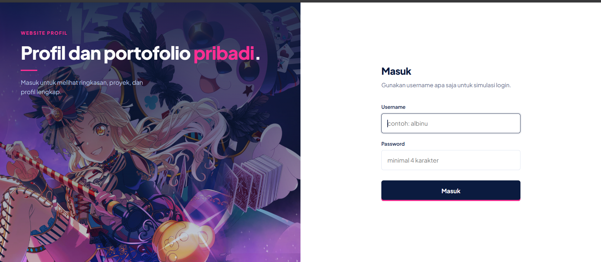
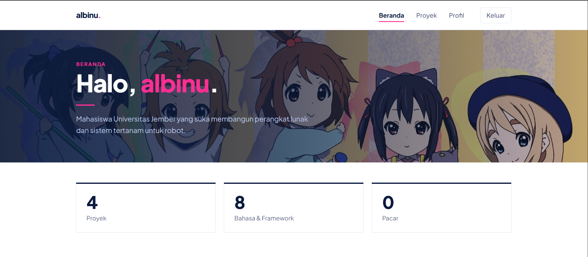
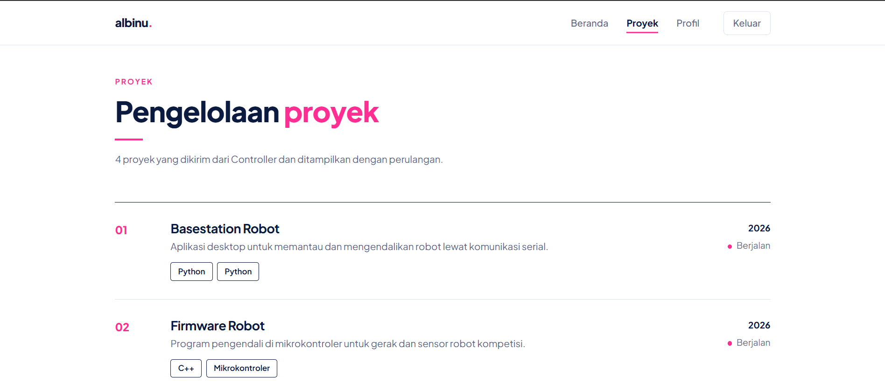
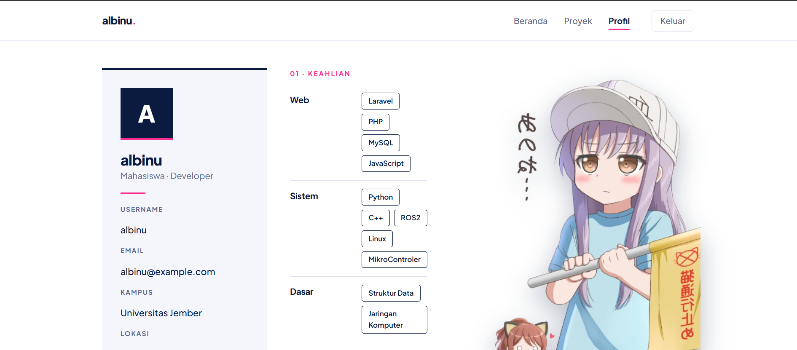

<div align="center">

# Website Profil Pribadi

**Aplikasi web responsif berbasis Laravel dengan arsitektur MVC dan templating Blade**


</div>

---

## Identitas

| | |
|---|---|
| **Nama** | [Aluber Qolbiannur Karimullah] |
| **NIM** | [252410103063] |

---

## Tentang Project

Project ini adalah **website profil** yang dibuat dengan **Laravel** untuk memahami alur *request-response* pada pola **MVC**. Pengguna masuk lewat simulasi login, lalu username diteruskan ke halaman Dashboard dan Profil. Halaman Pengelolaan menampilkan daftar proyek dari array di Controller.

Seluruh tampilan memakai **Blade** dan **CSS**. Warna utamanya navy dan putih, dengan aksen pink.

**Tema pengelolaan:** pengelolaan proyek.

---

## Screenshot

### Halaman Login


### Dashboard (Beranda)


### Pengelolaan (Proyek)


### Profil


---

## Fitur

- **Simulasi login** dengan validasi form (`username` dan `password`).
- **Request parameter:** username dikirim ke Dashboard dan Profil lewat URL (`?username=...`).
- **Rendering data dinamis:** daftar proyek, statistik, keahlian, dan mata kuliah dikirim dari Controller lalu ditampilkan dengan `@foreach`.
- **Tampilan responsif** untuk desktop, tablet, dan HP (menu berubah jadi tombol pada layar kecil).
- **Blade Component** untuk Navbar dan Footer yang dipakai ulang di semua halaman.

---

## Teknologi

| Bagian | Yang digunakan |
|---|---|
| Framework | Laravel |
| Bahasa | PHP, HTML, CSS |
| Templating | Blade (`@extends`, `@section`, `@yield`, `@include`, x-component) |
| Styling | CSS murni (Grid, Flexbox, media query) |
| Font | Plus Jakarta Sans (Google Fonts) |

---

## Struktur File

```
├── routes/
│   └── web.php
│
├── app/Http/Controllers/
│   └── PageController.php
│
└── resources/views/
    ├── layouts/
    │   └── app.blade.php
    │
    ├── login.blade.php
    ├── dashboard.blade.php
    ├── pengelolaan.blade.php
    ├── profile.blade.php
    │
    ├── components/
    │   ├── navbar.blade.php
    │   └── footer.blade.php
    │
    └── partials/
        ├── styles.blade.php
        └── stat-card.blade.php
```

---

## Alur Aplikasi

```
Browser ──request──▶ Route ──▶ Controller ──▶ View (Blade) ──response──▶ Browser
```

1. Pengguna membuka `/` dan mengisi form login.
2. Form dikirim (POST) ke `/login`, lalu `PageController@authenticate` memvalidasi input.
3. Jika valid, Controller mengarahkan ke `/dashboard?username=...`.
4. `dashboard`, `profile`, dan `pengelolaan` membaca username dari request, menyiapkan data array, lalu mengirimnya ke View.
5. View merender data dengan Blade dan layout utama.

---

## Cara Menjalankan

```bash
# 1. Masuk ke folder project
cd nama-project

# 2. Install dependensi (jika belum)
composer install

# 3. Salin file environment dan buat app key
cp .env.example .env
php artisan key:generate

# 4. Jalankan server
php artisan serve
```

Buka **http://127.0.0.1:8000** di browser.

> Aplikasi ini tidak memakai database, jadi tidak perlu setting MySQL.
> Jika terjadi error session, ubah `SESSION_DRIVER=database` menjadi `SESSION_DRIVER=file` di file `.env`.

---

## Halaman dan Route

| Halaman | URL | Method | Keterangan |
|---|---|---|---|
| Login | `/` | GET | Form login |
| Proses login | `/login` | POST | Validasi lalu redirect ke dashboard |
| Dashboard | `/dashboard?username=` | GET | Sapaan, statistik, catatan terbaru |
| Pengelolaan | `/pengelolaan?username=` | GET | Daftar proyek |
| Profil | `/profile?username=` | GET | Identitas, keahlian, pendidikan |
| Keluar | `/logout` | GET | Kembali ke login |

---

<div align="center">

Dibuat dengan Laravel dan Blade

</div>